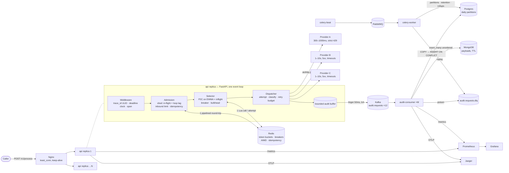
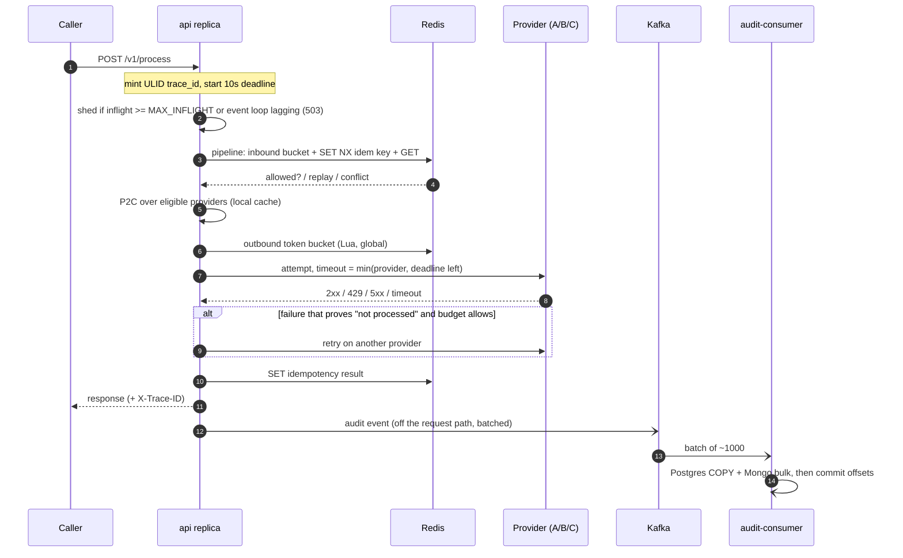

# Architecture

> **Principle.** Redis is the only datastore on the request path. Everything else lives
> behind a queue, so no database can slow down or fail a caller.

## Components and data flow

## Request lifecycle

## Where state lives

| State | Scope | Store | Freshness |
|---|---|---|---|
| Outbound token bucket per provider | global | Redis (Lua, per attempt) | exact |
| Effective RPS (AIMD), 429 block window | global | Redis, cached locally | ≤ 200 ms |
| Circuit breaker state + 10×1s counts | global | Redis, cached locally | ≤ 200 ms |
| Half-open probe lock | global | Redis `SET NX PX` | exact |
| Inbound token bucket per API key | global | Redis (Lua, per request) | exact |
| Idempotency records | global | Redis, TTL 24h | exact |
| EWMA latency, in-flight, bulkhead | per replica | memory | exact |
| Retry budget | per replica | memory | exact |
| Load-shedding counter | per replica | memory | exact |
| Audit summary | durable | Postgres | ~0.1–1 s behind |
| Audit payload | durable | MongoDB | ~0.1–1 s behind |

## Failure modes

| Failure | Effect on callers | Mechanism |
|---|---|---|
| Provider slow / erroring | Traffic moves to healthier providers | EWMA in P2C, circuit breaker, bulkhead |
| Provider rate-limits (429) | Spill-over to others; A's real limit is learned | AIMD + Retry-After block window |
| Upstream brownout | Retries capped at ~10% of traffic | Retry budget |
| Overload (too many in flight) | Fast 503 + Retry-After, no queueing past the deadline | In-flight cap at admission |
| CPU starvation (own load or a busy host) | Progressive 503s instead of everyone timing out; providers are not blamed | Event-loop-lag shedding; lag-time timeouts don't count against breakers |
| Redis down | Keeps serving on local per-replica limits; idempotent requests get 503 | Degrade-open |
| Kafka down | Keeps serving; audit events dropped and counted | Bounded buffer |
| Postgres / Mongo down | Keeps serving; consumer stops committing, catches up later | Kafka retention |
